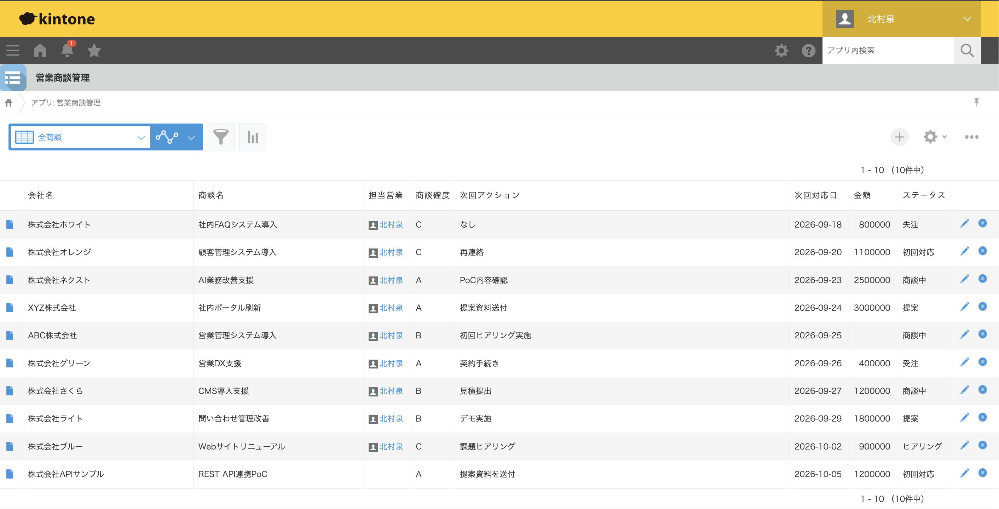
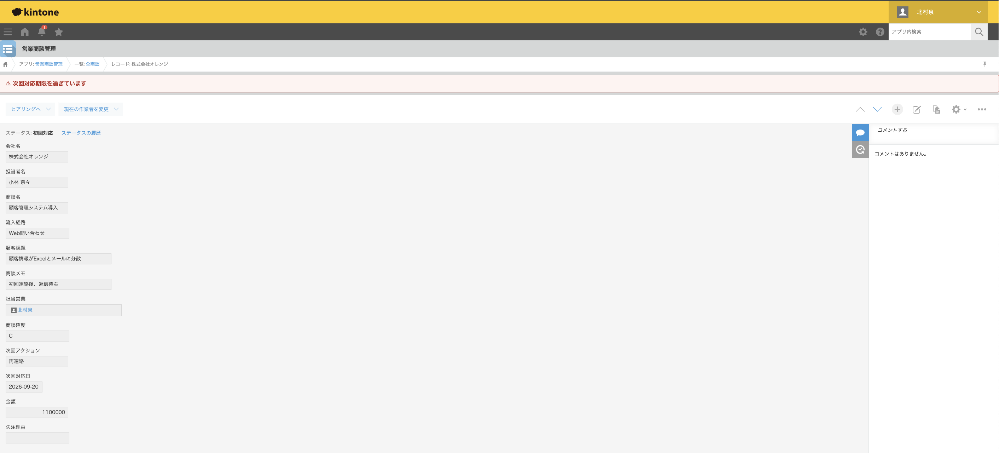
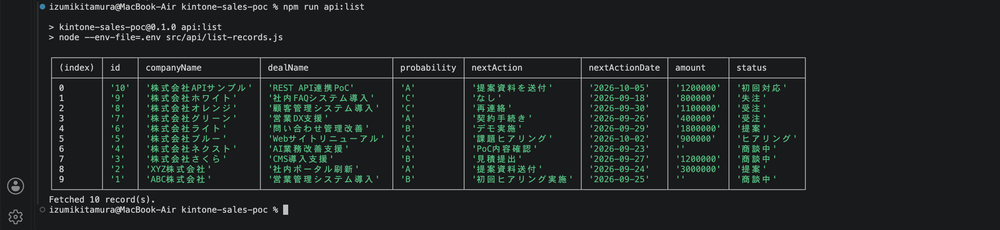
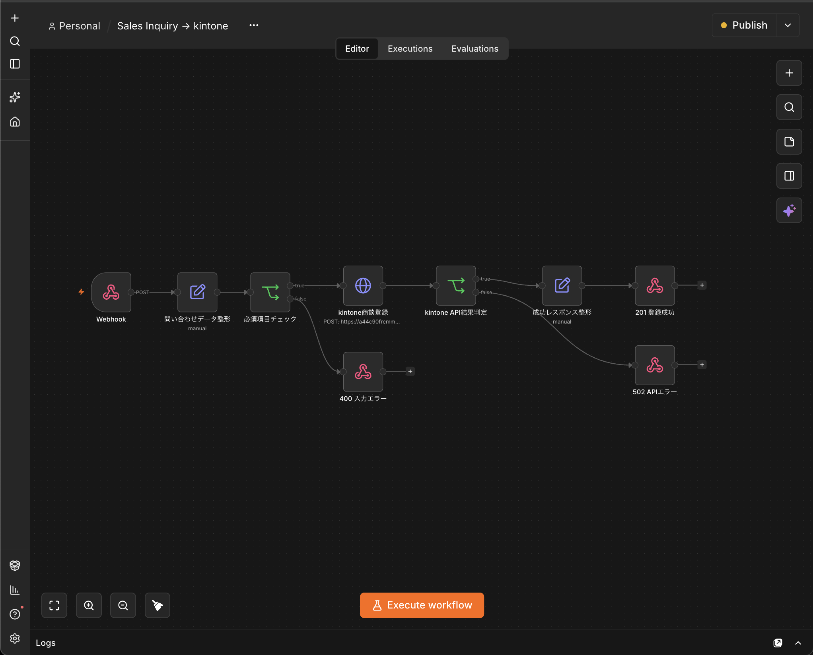
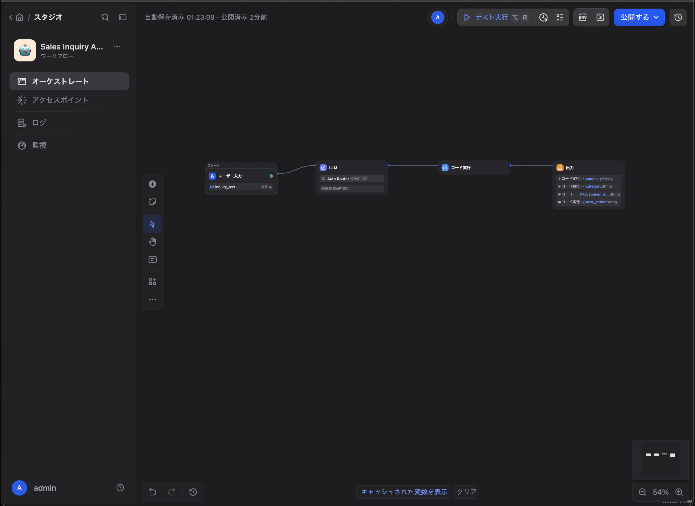

# kintone-sales-poc

BtoB営業部門の商談管理を題材にした、kintone + n8n + Dify 業務改善PoCです。

## 目的

Excel・メール・個人管理に分散した営業情報をkintoneへ集約し、
商談進捗、担当者、次回対応、商談確度、金額などを一元管理します。

あわせて、n8nでWeb問い合わせを受け付け、Difyで問い合わせ内容をAI分析し、kintoneへ商談を自動登録する構成を段階的に検証しています。

## デモ

### 商談一覧



### 期限超過警告



### REST API実機確認



### n8n問い合わせ自動登録フロー



### Dify営業問い合わせ分析Workflow



## 想定課題

- 商談情報が複数ツールに分散している
- Excelへの転記が発生している
- 次回対応日の見落としが起きる
- 商談ステータスを一覧で把握しづらい
- 担当者ごとに記録粒度が異なる
- Web問い合わせ受付後の転記・登録作業が手作業になっている

## 進捗

- [x] kintone開発者環境
- [x] 営業商談管理アプリ設計
- [x] フォーム / フィールドコード
- [x] プロセス管理
- [x] 一覧
- [x] ダミーデータ
- [x] 期限超過警告
- [x] 受注・失注時の業務ルール制御
- [x] REST API実機検証（GET / POST / PUT / プロセス遷移）
- [x] APIテスト結果反映
- [x] kintone編のポートフォリオ仕上げ
- [x] n8n連携（Webhook → 入力検証 → kintone自動登録）
- [x] n8n正常系 / 入力エラー / APIエラー検証
- [x] Dify連携（要約 / 分類 / 顧客課題抽出 / 次回アクション生成 / API実行）
- [ ] n8n + Dify + kintone統合PoC

## PoC範囲

1. kintoneアプリ設計
2. 一覧・プロセス管理
3. ダミーデータ投入
4. JavaScriptカスタマイズ
5. REST API連携
6. n8n Webhook / kintone自動登録
7. 入力・APIエラーハンドリング
8. Difyによる問い合わせAI分析
9. Dify Workflow API実行
10. テスト
11. As-Is / To-Be整理

## JavaScriptカスタマイズ

- 次回対応期限を過ぎた未完了案件に警告を表示
- 「受注」へ進む場合は金額を必須化
- 「失注」へ進む場合は失注理由を必須化

## REST API

Node.js 20+ の標準 `fetch` を利用し、外部から次の操作を実機検証しました。

- 商談一覧取得（GET） ✅
- 新規商談登録（POST） ✅
- 商談更新（PUT） ✅
- プロセス管理のアクション実行（PUT） ✅

実機検証では、APIで作成したレコードを取得し、商談確度・次回アクション・次回対応日を更新後、
プロセス管理を「新規」から「初回対応」へ遷移できることまで確認しています。

セットアップと実行方法は `docs/rest-api.md` を参照してください。

## n8n連携

n8n Community EditionをDocker Composeでローカル起動し、Web問い合わせをkintoneへ自動登録するWorkflowを構築しました。

```text
Webhook
↓
問い合わせデータ整形
↓
必須項目チェック
├─ false → 400 入力エラー
└─ true
    ↓
  kintone商談登録
    ↓
  kintone API結果判定
    ├─ success → 201 登録成功
    └─ error   → 502 APIエラー
```

Production Webhookで次のケースを確認済みです。

- 正常登録: `201 Created`
- 必須項目不足: `400 Bad Request`
- kintone API失敗: `502 Bad Gateway`

kintone APIトークンはWorkflow JSONへ直接保存せず、n8n Credentialsへ分離しています。

セットアップ、Workflow構成、Webhook、テスト結果の詳細は `docs/n8n.md` を参照してください。

## Dify連携

Dify Workflowで問い合わせ本文を分析し、`summary` / `category` / `customer_issue` / `next_action` の4項目へ構造化します。

```text
ユーザー入力
↓
LLM
↓
コード実行
↓
出力
```

PoCで使用したモデルではStructured Outputがネイティブ対応しなかったため、LLMのJSON出力をCode Nodeで解析するフォールバックを実装しました。公開Workflow APIから4項目を正常取得できることまで確認しています。

Workflow構成、API実行、フォールバック処理の詳細は `docs/dify.md` を参照してください。

## ポートフォリオ

- ケーススタディ: `docs/portfolio.md`
- スクリーンショット一覧: `docs/screenshots.md`

## アプリの主なフィールド

| 項目 | フィールドコード |
| --- | --- |
| 会社名 | `company_name` |
| 担当者名 | `contact_name` |
| 商談名 | `deal_name` |
| 流入経路 | `lead_source` |
| 顧客課題 | `customer_issue` |
| 商談メモ | `deal_memo` |
| 担当営業 | `sales_rep` |
| 商談確度 | `probability` |
| 次回アクション | `next_action` |
| 次回対応日 | `next_action_date` |
| 金額 | `amount` |
| 失注理由 | `lost_reason` |

## プロセス

`新規 → 初回対応 → ヒアリング → 提案 → 商談中 → 受注 / 失注`

## ディレクトリ

```text
.
├─ README.md
├─ package.json
├─ .env.example
├─ .gitignore
├─ data/
│  └─ dummy-sales.csv
├─ docs/
│  ├─ images/
│  ├─ as-is.md
│  ├─ to-be.md
│  ├─ app-design.md
│  ├─ portfolio.md
│  ├─ rest-api.md
│  ├─ n8n.md
│  ├─ dify.md
│  ├─ screenshots.md
│  └─ test-plan.md
├─ n8n/
│  ├─ compose.yml
│  └─ workflows/
│     └─ sales-inquiry-to-kintone.json
├─ dify/
│  └─ workflows/
│     └─ sales-inquiry-analyzer.yml
└─ src/
   ├─ customization/
   │  └─ sales-poc.js
   └─ api/
      ├─ kintone-client.js
      ├─ list-records.js
      ├─ create-record.js
      ├─ update-record.js
      └─ update-status.js
```

## 今後の拡張

- n8n + Dify + kintoneの統合
- Dify出力をkintone項目へ自動マッピング
- Teams等への担当者通知

## 注意

このリポジトリには実在顧客の情報、APIトークン、認証情報を保存しません。
掲載データはすべて架空データです。
