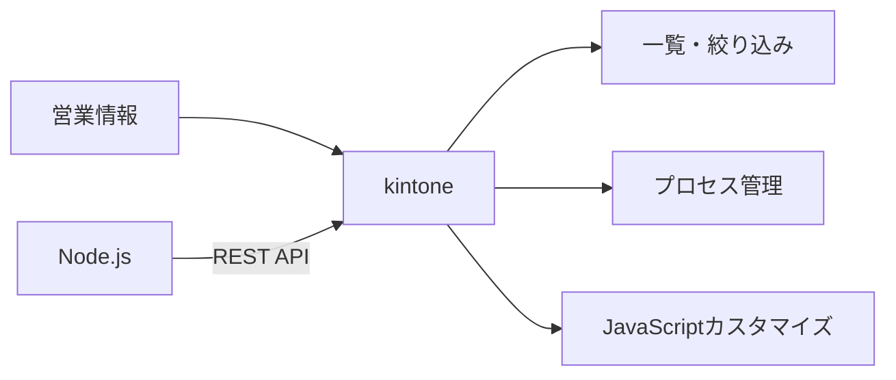
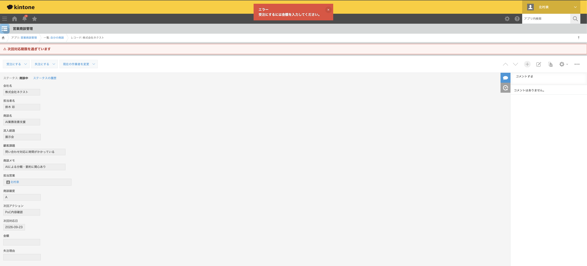
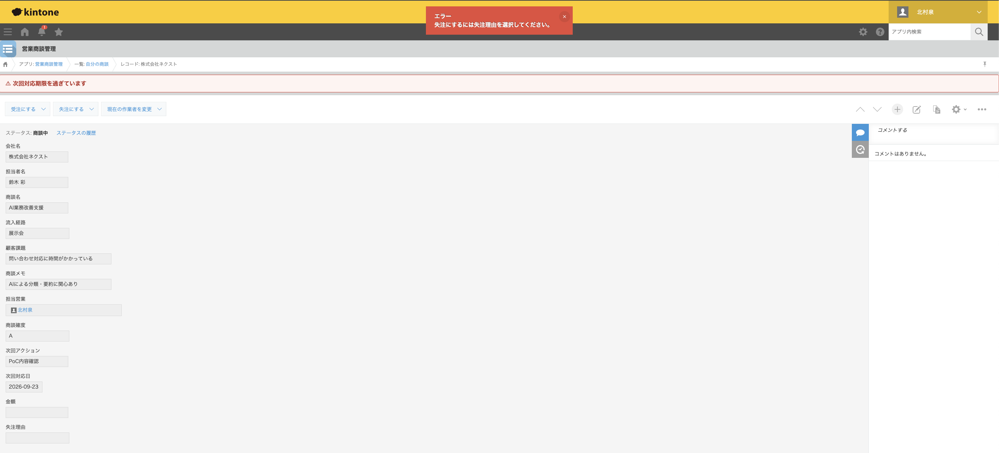
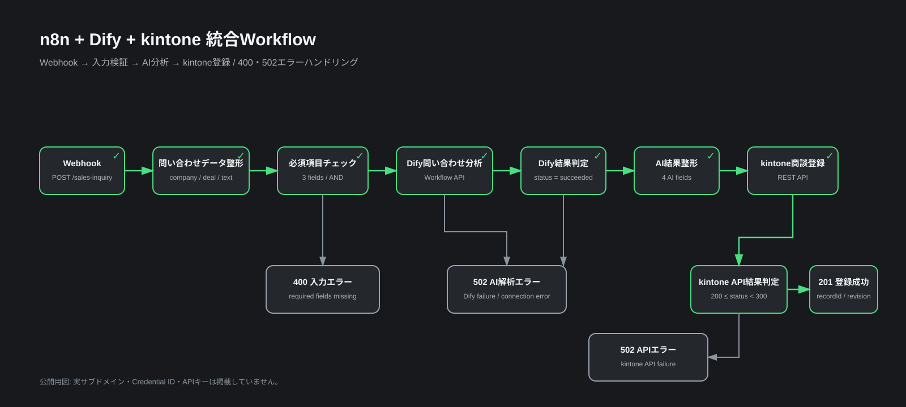

# ポートフォリオ概要

## BtoB営業部門の商談管理改善PoC

### 背景

法人営業部門で、問い合わせ・商談情報がメールやExcel、担当者個人の管理に分散している状況を想定しました。

その結果、次の課題が発生すると仮定しています。

- 商談情報の転記作業
- 次回対応日の見落とし
- 案件進捗の把握に時間がかかる
- 担当者ごとに記録粒度が異なる
- 受注・失注時に必要情報が欠落する

### 改善方針

kintoneを商談管理の中心に置き、標準機能で管理基盤を構築したうえで、
JavaScriptとREST APIで不足する業務ルール・外部連携を補完しました。



## As-Is

```text
Web問い合わせ
↓
メール確認
↓
Excelへ転記
↓
問い合わせ内容を担当者が読み取り
↓
担当者決定
↓
ヒアリング
↓
提案
↓
Excel更新
↓
次回アクションを個人管理
```

## To-Be

```text
Web問い合わせ
↓
n8n
↓
Dify / LLM
├─ 要約
├─ カテゴリ分類
├─ 顧客課題抽出
└─ 次回アクション生成
↓
kintoneへ商談登録
↓
担当営業を設定
↓
プロセス管理
↓
次回対応日・アクションを一元管理
↓
受注 / 失注
```

## 実装内容

### kintone標準機能

- 商談情報の一元管理
- 商談確度・担当営業・次回対応日の管理
- 一覧・絞り込み
- プロセス管理
- 受注 / 失注までの進捗管理


### JavaScriptカスタマイズ

- 期限超過案件への警告表示
- 受注時の金額必須チェック
- 失注時の失注理由必須チェック


#### 受注時バリデーション



#### 失注時バリデーション



### REST API連携

Node.js 20+ の標準 `fetch` を利用して、次を実機検証しました。

- GET：商談一覧取得
- POST：新規商談登録
- PUT：商談情報更新
- PUT：プロセス管理アクション実行

APIで作成したレコードについて、商談確度・次回アクション・次回対応日を更新し、
さらに「新規」から「初回対応」へプロセス遷移できることまで確認しています。


### n8n連携

n8n Community EditionをDocker Composeでローカル起動し、Web問い合わせからkintone登録までのWorkflowを構築しました。

```text
Webhook
↓
問い合わせデータ整形
↓
必須項目チェック
├─ false → 400 入力エラー
└─ true
    ↓
  kintone商談登録
    ↓
  kintone API結果判定
    ├─ success → 201 登録成功
    └─ error   → 502 APIエラー
```

Production Webhookで次を実機確認しています。

- 正常登録：`201 Created`
- 必須項目不足：`400 Bad Request`
- kintone API失敗：`502 Bad Gateway`
- 正常登録時に`recordId` / `revision` を返却
- APIトークンをWorkflow JSONへ直接保存せず、n8n Credentialsへ分離


詳細は [n8n連携ドキュメント](n8n.md) を参照してください。

### Dify連携

Dify Workflowで問い合わせ本文を分析し、営業担当者が初回対応に利用できる情報へ構造化しました。

```text
問い合わせ本文
↓
LLM
↓
コード実行
↓
summary
category
customer_issue
next_action
```

LLMでは問い合わせ要約、カテゴリ分類、顧客課題抽出、次回アクション生成を行います。

PoCで利用したOpenRouterモデルはDifyのStructured Outputへネイティブ対応しなかったため、公開APIでStructured Outputの子変数を直接参照すると `null` になるケースがありました。そこでLLMのJSON文字列をCode Nodeで解析し、4項目をフラットな出力へ変換するフォールバックを実装しています。

公開Workflow APIから4項目が実値で返ることまで確認済みです。


詳細は [Dify連携ドキュメント](dify.md) を参照してください。

### n8n + Dify + kintone統合

Webhookで受け取った問い合わせをn8nで入力検証し、Dify Workflow APIでAI分析した後、分析結果をkintoneへ自動登録するE2Eフローを実装しました。

```text
Web問い合わせ
↓
n8n
↓
Dify API
├─ 要約
├─ カテゴリ分類
├─ 顧客課題抽出
└─ 次回アクション生成
↓
n8n
↓
kintone
```



実機テストでは、正常登録に加えて次の異常系まで確認しています。

- 必須項目不足 → `400 Bad Request`
- Dify停止 / 接続不能 → `502 Bad Gateway`
- kintone API失敗 → `502 Bad Gateway`
- 正常系ではAI生成した要約・カテゴリ・顧客課題・次回アクションをkintoneへ反映

詳細は [統合ドキュメント](integration.md) を参照してください。

## 応募時に伝える要点

このPoCは、本番導入効果を示すものではなく、自主検証として「課題整理 → 設計 → 実装 → 正常系・異常系テスト → 共有可能な成果物化」まで一連で行ったものです。

特に、n8n単体でも実現可能なAI処理をDifyへ分離し、AI処理の再利用や将来的なRAG拡張を想定した構成を検証した点、Dify停止やkintone API失敗までエラー系を実装した点を説明できます。

面談用の30秒版・90秒版、技術選定の説明、トラブル対応例は [応募・面談向け説明](application-pitch.md) にまとめています。

## 技術選定の考え方

最初からすべてコードで作らず、kintone標準機能で解決できる範囲を優先しました。

そのうえで、標準機能だけでは不足する「期限超過警告」「業務ルール制御」をJavaScriptで追加し、
外部システム連携に必要な操作をREST APIで検証しています。

問い合わせ受付からkintone登録までの連携にはn8nを利用し、処理の可視化とエラーハンドリングをWorkflowとして分離しました。
これにより、アプリ側の業務ロジックと外部連携処理を分けて管理できる構成にしています。

AI処理はDifyへ分離し、プロンプト・モデル・構造化出力をn8nの連携処理から独立して管理できる構成を検証しました。単純なAI呼び出しであればn8n単体でも実装可能ですが、AI処理の再利用や将来的なRAG追加を想定した場合の分離パターンとしてDifyを採用しています。

## 想定効果

PoC段階のため実測値ではありませんが、導入時には次をKPI候補とします。

- Excelへの転記件数
- 問い合わせ受付からkintone登録までの処理時間
- 商談情報確認に要する時間
- 次回対応期限の超過件数
- 必須情報の欠落件数
- 商談進捗確認に要する時間

## 今後の拡張

- Teams等への担当者通知
- DifyへのRAG追加
- 担当営業の自動アサイン
- 処理時間・エラー率・AI利用量の可視化

## このPoCで確認できたこと

- 業務課題からkintoneのデータ構造へ落とし込む
- 標準機能とカスタマイズの使い分け
- JavaScriptによる業務ルール実装
- REST APIによる外部システム連携
- n8nによるWebhook受付・入力検証・kintone自動登録
- HTTPステータスを使った正常系 / 入力エラー / APIエラーの分岐
- Difyによる問い合わせ要約・分類・顧客課題抽出・次回アクション生成
- Structured Output非対応モデルに対するCode Nodeフォールバック
- Dify Workflow APIによる外部実行
- n8n → Dify → kintoneのE2E自動化
- Dify接続不能時のError Output分岐と502応答
- 認証情報をGit管理から分離した開発構成
- テストケースを定義した実機検証
